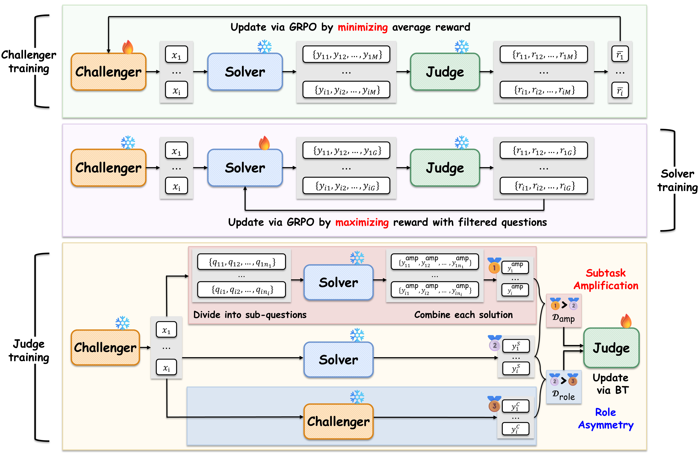

# *J-Zero*: Unified Challenger--Solver--Judge Self-Evolution from Zero Data

[](https://arxiv.org/abs/2608.26582)  [](#bibtex)

> Check out our [paper](https://arxiv.org/abs/2608.26582) or [webpage](https://gyoukchu.github.io/projects/j_zero/) for the details.

---

## 🔔 Updates
- [✔] (26.08.28) The code implementation of J-Zero is out.
- [✔] (26.08.27) Paper is out! [Link](https://arxiv.org/abs/2608.26582) 

---

## 🔎 Overview

<p align="center">
  
</p>

> A unified LLM Zero-data Self-play framework that enables self-evolving in both verifiable and **unverifiable** domain, where **Judge co-adapts alongside the Challenger and Solver**.

In unverifiable domains, reward models provide preference-based supervision for improving model capabilities; however, the extent of self-improvement may ultimately be constrained by the judge model’s own evaluation capability.

To resolve this, J-Zero co-evolves the Judge under two constraints:
1. Preference pairs must be constructed entirely within the closed loop, ***without external supervision***.
2. **Their labels must not depend on signals produced by the Judge itself**, both to avoid self-bias and to allow correction of any miscalibration in the current Judge.

To satisfy these two, we construct preference pairs from the outputs of Challenger and Solver, namely ***role-asymmetry*** and ***subtask-amplification***. Check out our [paper](https://arxiv.org/abs/2608.26582) for the details.

### J-Zero Self-Play Loop

Each iteration trains all three agents, each initialized from the previous round:

| | Agent | Objective | Trainer |
|---|---|---|---|
| Stage 1 | **Challenger** | generate well-formed questions the current Solver scores *low* on | GRPO ([verl](https://github.com/volcengine/verl)) |
| Stage 2 | **Solver** | answer Challenger's questions | GRPO (verl) |
| Stage 3 | **RM** | provide accurate rewards | FSDP BT ([`pipeline/rm_train_loop.py`](pipeline/rm_train_loop.py)) |

Solver and Challenger start from `BASE_MODEL` — the shipped runs use
Qwen3-4B-Base, Qwen3-8B-Base and Llama-3.2-3B-Instruct (one launcher each, see
[Usage](#-usage)); the Judge starts from
`Skywork/Skywork-Reward-V2-Llama-3.1-8B` and is continued round-over-round.

---

## 🔧 Environments and Setup

**Hardware**: one node with 4 GPUs per experiment (validated on 4xB200; the 8B config fits via CPU offload — see `launch/run_jzero_8b.sh`).

We provide several mutually-incompatible environments (e.g. vLLM 0.11 vs 0.23) that we have used in `requirements/`. Install cleanly from scratch with `uv pip install -r <file>`.

| file | Python | key pins | used for |
|---|---|---|---|
| `requirements-train-vllm011.txt` | 3.12 | torch 2.8, vLLM **0.11**, transformers **4.56** | **Default training env**: all J-Zero / R-Zero / G-Zero runs on Qwen3-4B/8B-Base and Llama-3.2-3B-Instruct |
| `install_train_env_vllm023.sh` | 3.12 | torch 2.11, vLLM **0.23**, transformers **5.6.0 or 5.12.1** | Same pipelines, but for base models vLLM 0.11 cannot load (Qwen3.5, Gemma4, …), plus generation from checkpoints those runs produce — vLLM 0.11 mis-detokenizes transformers-5-saved checkpoints |
| `requirements-eval.txt` | 3.12 | vLLM **0.23** (cu130 index) | all benchmark judge/test serving |
| `requirements-eval-genbench.txt` | 3.10 | alpaca_eval deps | AlpacaEval / EQ-Bench orchestration |
| `requirements-eval-arena.txt` | 3.12 | torch +cpu index | Arena-Hard-Auto harness |

IFEval needs NLTK tokenizer data that pip does not ship.
`install_train_env_vllm023.sh` downloads it; after installing
`requirements-train-vllm011.txt` do it yourself, once, while you have network:

(Note that training does not need it — see `benchmarks/README.md` ("One-time setup"))

```bash
python -m nltk.downloader punkt_tab
```

Training additionally requires **verl installed editable** at the revision the
released runs used — clone
[volcengine/verl](https://github.com/volcengine/verl) and pin
`accb1a07d22b516a2a4e607a7891b8dea0897b91` (the patch below is
generated against this revision):

```bash
git clone https://github.com/volcengine/verl && cd verl
git checkout accb1a07d22b516a2a4e607a7891b8dea0897b91
uv pip install --python /path/to/venv/bin/python -e . --no-deps
```

(`uv venv` does not put a `pip` inside the venv, so `pip install -e .` fails
there — use the `uv pip` form above, or create the venv with `uv venv --seed`.)

Place this repo's `pipeline/` directly inside the verl checkout as
`<verl>/recipe_J-Zero` (the `launch/` wrappers expect that name; override with
`RECIPE_DIR`), and `baselines/r-zero/` likewise as `<verl>/recipe_R-Zero`. The
benchmark suite's math phase takes the baseline install location via its own
`RECIPE_DIR` env var (any path works — it just needs `evaluate/` from
`baselines/r-zero/`).

**Required verl patch** — the released runs were trained on a locally patched
verl core, not stock upstream:

```bash
cd /path/to/verl && git apply /path/to/repo/patches/verl-core-rzero-fixes.patch
```

<details>
<summary>patch information</summary>

It covers master-port selection, reward-fn registration, distributed init, the
async vLLM rollout server, and stage teardown.
The teardown hunk matters for reading logs: unpatched, every verl stage ends a
successful, checkpoint-saved run with a wandb `Tracking.__del__` traceback
(`ValueError: Cannot use run() inside async loop`, then a closed-transport
follow-up), and often a torch DataLoader one (`RuntimeError: DataLoader worker
(pid …) is killed by signal: Killed` — this one is intermittent, it needs a
worker to be killed while torch's SIGCHLD handler is still armed). Both are
teardown noise that says nothing about the run, but they make a 15-round launcher
impossible to judge from its log. Patched, trainer tracebacks on a successful
stage are largely gone, and a stage that raised is also filed as failed in wandb
rather than green. Not all of them: the solver stage can still emit one wandb
`Tracking.__del__` traceback, because that object is collected while `fit()` is
still running and the patch's teardown runs after it returns.

What the patch does **not** silence is vLLM's own shutdown: the rollout-server
actors can still emit `multiprocessing/resource_tracker.py … KeyError: '/psm_…'`
or `'/loky-…'` while releasing shared-memory segments. That is a stock
CPython/vLLM teardown race in a different process, its count varies run to run,
and it is unrelated to whether the stage succeeded.

**TRTLLM attention on SM100 (B200-class).** A colocated rollout EngineCore can
futex-deadlock on idle/resume while TRTLLM-gen attention is active, so all three
training pipelines keep it off. How that is achieved differs per environment:

| environment | how TRTLLM attention is disabled |
|---|---|
| vLLM **0.11** training env (`requirements-train-vllm011.txt`) | `VLLM_ATTENTION_BACKEND=FLASH_ATTN` (+ the `VLLM_USE_FLASHINFER*` knobs) pinned in `pipeline/env_prelude.sh`, `baselines/r-zero/env_prelude.sh` and `g_zero/local_backend.py`. FlashInfer is never selected, so TRTLLM attention never engages. No patch needed. |
| vLLM **0.23** judge/eval env (`requirements-eval.txt`) | apply `patches/vllm023-disable-trtllm-attn.patch` and export `VLLM_DISABLE_TRTLLM_ATTN=1` (`benchmarks/scripts/eval_gen/serve_judge_vllm.sh` does this). |

`VLLM_DISABLE_TRTLLM_ATTN` is introduced by that patch — stock vLLM of **any**
version ignores it, so it does nothing in the 0.11 env. vLLM 0.11's own switch,
if you ever want FlashInfer there, is upstream `VLLM_USE_TRTLLM_ATTENTION=0`.
</details>

---

## 🚀 Usage

### J-Zero

One-time setup: `cp .env.example $PROJECT_ROOT/.env` and fill `HF_TOKEN`
(+ `WANDB_API_KEY`, or set `WANDB_MODE=offline`); copy the three val parquets
`cp benchmarks/data/{math500,minervamath,olympiadbench}.parquet $PROJECT_ROOT/data/`
(loaded by the solver trainer at init); pre-download the base model and
`Skywork/Skywork-Reward-V2-Llama-3.1-8B` into your HF cache — the pipeline
defaults to `HF_HUB_OFFLINE=1` (export `HF_HUB_OFFLINE=0` to allow first-run
downloads).

Then run:

```bash
PROJECT_ROOT=/abs/path/project \    # holds .env, data/ (val parquets), outputs/
VERL_REPO=/abs/path/verl \    # verl checkout with pipeline/ installed inside
RZERO_VENV_ACTIVATE=/abs/path/venv/bin/activate \
bash launch/run_jzero_4b.sh    # Qwen3-4B-Base, rounds 1-15
# same contract:
bash launch/run_jzero_8b.sh    # Qwen3-8B-Base, rounds 1-10 (adds the 8B CPU-offload)
bash launch/run_jzero_llama3b.sh   # Llama-3.2-3B-Instruct, rounds 1-15 (note that Llama-3.2-3B is a gated hug repo)
```

Custom runs go through the core launcher directly:

```bash
PROJECT_ROOT=... VERL_REPO=... RZERO_VENV_ACTIVATE=... \
RZERO_NITER=10 RZERO_TAG=my_run BASE_MODEL=Qwen/Qwen3-4B-Base \
bash launch/launch_jzero_4gpu.sh
```

- `SMOKE=1` runs a tiny end-to-end pre-flight (100 questions, 1 round).
- Resume: completed challenger/solver/RM checkpoints are detected and skipped;
  rerun the same wrapper (or set `RZERO_START_ITER`) to continue.
- Stage 3 uses the challenger-negative + IDA subtask pair builders (the paper method).
- The wrappers take `${VAR:-default}` for `BASE_MODEL`, `RZERO_NITER`,
  `CKPT_ROOT` and `OUT_ROOT`, so a released run can be shortened in place:
  `RZERO_NITER=3 bash launch/run_jzero_4b.sh`. `RZERO_TAG` is fixed per wrapper
  because it names the released checkpoint directories — use
  `launch/launch_jzero_4gpu.sh` directly to change it. The G-Zero launchers take
  `G_ZERO_NROUNDS` for the same purpose (see the contract table below).
- Per-iteration eval is **off** by default (the paper numbers come from the
  post-hoc 14-benchmark sweep). Set `RZERO_SKIP_PER_ITER_EVAL=0` — or its alias
  `RZERO_SKIP_ITER_EVAL=0` — plus `RZERO_EVAL_SCRIPT` to enable it. The same
  contract applies to `baselines/r-zero/run_rzero.sh`.

### Baselines

- **R-Zero** — [`baselines/r-zero/`](baselines/r-zero/): the verl recipe, the
  launchers of the paper runs (Qwen3-4B/8B, Llama-3.2-3B). See
  [`baselines/r-zero/RUNS.md`](baselines/r-zero/RUNS.md).
- **G-Zero** — [`baselines/g-zero/`](baselines/g-zero/): the fully-local
  (vLLM + peft LoRA DPO) fork used for the paper runs, with its own README
  and one launch script per released run.

### Entrypoint env-var contract

The three entrypoints grew independently and do **not** take the same variables.
Export the "required" ones for whichever one you are running:

| | J-Zero (`launch/`) | R-Zero (`baselines/r-zero/launchers/`) | G-Zero (`baselines/g-zero/scripts/`) |
|---|---|---|---|
| Python env | `RZERO_VENV_ACTIVATE` — path to the **`activate` file** (required) | `RZERO_VENV` — the **venv directory** (required; the script appends `/bin/activate`) | `G_ZERO_PY` — a **python executable** (optional, defaults to `python`) |
| Secrets | `$PROJECT_ROOT/.env` (required; **hard-fails** on a missing `HF_TOKEN`, and on `WANDB_API_KEY` unless `WANDB_MODE=offline`) | `RZERO_ENV_FILE` — path to the env file (required; **no** key validation) | not needed |
| Output root | `PROJECT_ROOT` (required) → `outputs/`; `OUT_ROOT` overrides | `OUT_ROOT` (required) | `G_ZERO_STORAGE` (optional, defaults to `baselines/g-zero/runs`) |
| Checkpoints | `CKPT_ROOT` (optional, defaults under `VERL_REPO`) | `CKPT_ROOT` (required) | inside `G_ZERO_STORAGE` |
| verl checkout | `VERL_REPO` (required), recipe at `$VERL_REPO/recipe_J-Zero` (`RECIPE_DIR` overrides) | recipe dir is the launcher's parent — no variable | not used (no verl) |
| Val parquets | `$PROJECT_ROOT/data` | `DATA_DIR` (see [`RUNS.md`](baselines/r-zero/RUNS.md)) | not used |
| Smoke run | `SMOKE=1` (+ `RZERO_SMOKE_*`) | `SMOKE=1` (+ `RZERO_SMOKE_*`) | `SMOKE=1` (+ `G_ZERO_SMOKE_*`) |
| Round count | `RZERO_NITER` | `RZERO_NITER` | `G_ZERO_NROUNDS` |

Note on where files land: the verl trainer runs from the recipe directory and
uses hydra, so **inside your verl checkout** each stage writes
`<verl>/recipe_J-Zero/outputs/<date>/<time>/{main_ppo.log,.hydra}` and wandb
writes `<verl>/recipe_J-Zero/wandb/` (same for `recipe_R-Zero`). These are
independent of `OUT_ROOT`/`PROJECT_ROOT`, they accumulate one directory per run,
and this repo's `.gitignore` does not reach them once the recipe has been copied
into verl — so `git status` in the verl checkout gets dirty. Set `WANDB_DIR` to
move the wandb half elsewhere (the offline-sync step follows it; the RM stage
always writes and syncs `<recipe>/wandb`).

### Evaluation

One command evaluates one checkpoint on all 14 benchmarks (math×7, EM×3
[MMLU-Pro/SuperGPQA/BBH], IFEval, AlpacaEval 2.0, Arena-Hard-v2.0, EQ-Bench
Creative v3) on 4 GPUs, using **local judges only — zero API calls**:

```bash
cd benchmarks
GPU_SET=0,1,2,3 bash scripts/eval_standard/run_eval.sh <ckpt> <slug>
```

Setup (one-time clones, env vars, judge models) is documented in
[`benchmarks/README.md`](benchmarks/README.md) and
[`benchmarks/THIRD_PARTY.md`](benchmarks/THIRD_PARTY.md).

## 📚 BibTeX
If you find this repo useful for your research, please consider citing us:

```
@article{chu2026jzero,
  title   = {J-Zero: Unified Challenger--Solver--Judge Self-Evolution from Zero Data},
  author  = {Chu, Gyouk and Jeon, Myeongho and Yeo, Teresa and Yang, Eunho},
  journal = {arXiv preprint arXiv:2608.26582},
  year    = {2026}
}
```

## ✉️ Contact
If you have any questions or feedback, feel free to reach out:
- Gyouk Chu: kyouwook@kaist.ac.kr
